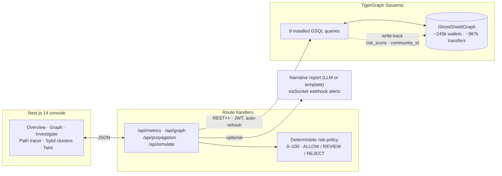
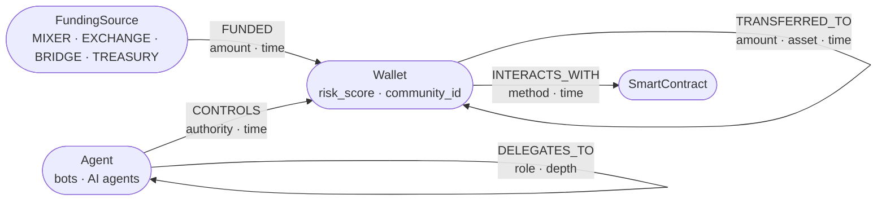

<div align="center">

<picture>
  <source media="(prefers-color-scheme: dark)" srcset="media/ghostshield-logo-horizontal-dark.svg">
  
</picture>

### Graph-native detection of laundering loops, Sybil farms and tainted funds, running inside TigerGraph.

[](https://github.com/Ridreb05/hhgoa/actions/workflows/ci.yml)
[](https://www.tigergraph.com/)
[](database/tigergraph/queries/)
[](https://nextjs.org/)
[](https://www.typescriptlang.org/)
[](tests/)

**[Problem](#problem)** ·
**[Results](#results)** ·
**[How it works](#how-it-works)** ·
**[Detectors](#detectors)** ·
**[Quickstart](#quickstart)** ·
**[Real data](#real-data)** ·
**[Limitations](#limitations)** ·
**[Docs](#documentation)**

</div>

---

> [!NOTE]
> **TL;DR.** Every individual transfer in a laundering loop or a Sybil farm looks normal. The fraud only exists in the *shape* of the activity: money returning to its origin within minutes, dozens of wallets funded in one burst and driven by one agent, risk leaking several hops out from a sanctioned address.
> GhostShield models wallets, funders, AI agents and contracts as a graph in **TigerGraph** and finds those shapes with **custom GSQL algorithms that run entirely in the database**. The Next.js console only renders what the engine returns.

<a id="problem"></a>

## 🎯 The problem

In permissionless systems a new wallet costs nothing, and autonomous AI agents can now create and operate thousands of them. Attackers use that to split one operation across many wallets so that **no single transaction breaks a rule**. Transaction monitoring that inspects rows of `(sender, recipient, amount, timestamp)` one at a time cannot see it.

GhostShield targets three patterns:

| Pattern | What the attacker does | Why row-by-row checks miss it |
|---|---|---|
| **Rapid circular flows** | Routes funds through puppet wallets in a closed loop within minutes, to fake volume, move AMM prices or obscure stolen funds while keeping control of them | Each hop is an ordinary transfer between valid accounts |
| **Sybil farms** | Funds dozens of fresh wallets from one mixer, bridge or exchange sweep and drives them with one bot or agent to farm airdrops, votes or incentives | Each wallet looks like an independent new user |
| **Taint by distance** | Moves sanctioned or stolen funds several hops away before they reach a counterparty | Only direct counterparties are checked |

<details>
<summary><b>Worked example: a 3-hop loop in 8 minutes</b></summary>

<br/>

| Time | Event | Seen in isolation |
|---|---|---|
| `T+00:00` | Mixer `FS_TORNADO_CASH_01` funds `Wallet_Alpha` with 10.0 ETH | A deposit |
| `T+00:02` | `Wallet_Alpha` → `Wallet_Beta`, 9.9 ETH | A normal transfer |
| `T+00:05` | `Wallet_Beta` → `Wallet_Gamma`, 9.8 ETH | A normal transfer |
| `T+00:08` | `Wallet_Gamma` → `Wallet_Alpha`, 9.7 ETH | A normal transfer |

Seen as a graph, this is a closed, time-ordered 3-cycle completed in 8 minutes, returning 97% of the value to its origin, funded by a mixer. Every row passes a threshold check; the shape does not.

</details>

### Who it is for

* **DeFi protocol security and risk teams** watching pools, bridges and lending markets for wash trading and Sybil manipulation.
* **Developers of autonomous financial agents** that need to check a counterparty before an agent signs a settlement.
* **Compliance and forensics investigators** who need explainable, time-bounded evidence paths rather than an opaque score.

### Why a graph, and why existing tools fall short

* **Multi-hop questions need traversal.** A 3–5 hop loop with a time rule on every hop is 3–5 self-joins of the transfers table in SQL, with the search space growing at each join. In TigerGraph it is a bounded traversal that runs in parallel across vertices, with accumulators carrying the path state.
* **Topology alone is not enough.** Standard cycle detection (Johnson's algorithm, GDS cycle detection) reports every loop, including ones that formed over months through normal arbitrage and rebalancing. GhostShield requires time order and a closing window, which is what took precision from 2.4% to 100% on our benchmark.
* **Enterprise forensics is closed.** Tools such as Chainalysis, Elliptic and TRM rely on proprietary attribution databases and batch scoring. GhostShield is open, runs on your own graph, and is fast enough to sit in front of a transaction as a pre-execution check.

### Scope

| GhostShield does | GhostShield does not |
|---|---|
| Score proposed transactions and wallets as `ALLOW`, `REVIEW` or `REJECT`, with the evidence behind each score | Sign, broadcast or block live transactions; it is an advisory gateway |
| Run bounded, parameterised traversals (depth and time windows) | Run unbounded traversals that could exhaust the database |
| Report corroborating risk signals for an analyst | Claim that a cycle or a shared funder proves criminal intent |
| Fail loudly when the live engine errors | Silently fall back to demo data |

More: [`docs/PROBLEM_STATEMENT.md`](docs/PROBLEM_STATEMENT.md) · [`docs/PRIOR_ART.md`](docs/PRIOR_ART.md)

<a id="results"></a>

## 📊 Results at a glance

**Synthetic benchmark** (planted ground truth *and* planted hard negatives)

| Detector | Precision | Recall |
|---|:---:|:---:|
| Temporal cycles (3–5 hops) | **100%** | **100%** |
| Sybil clusters | **80%** | **100%** |
| Risk propagation (top-k) | **100%** | **100%** |

0 of 40 slow "decoy" cycles flagged. Quality is unchanged from 88k to **~987k transfers**; cycle detection goes from 0.4 s to 2.4 s.

**Real data** (weaknesses included, see [Real data](#real-data))

| Dataset | Result |
|---|---|
| **Elliptic Bitcoin** (4,545 illicit labels, held-out) | Taint AUC **0.887** vs 0.849 for plain hop distance |
| **Ethereum mainnet** (600 blocks, 47,715 edges) | 272 time-ordered cycles, **exact match** with an independent recount |

**What the graph buys you.** The same questions answered without multi-hop, time-aware traversal ([`docs/BASELINES.md`](docs/BASELINES.md)):

| Question | Naive baseline | GhostShield |
|---|---|---|
| Round trips | Any 3–5 hop cycle, ignoring time: **2.4%** precision | Time-ordered, windowed: **100%** precision |
| Sybil farms | "Wallets sharing a funder": **14.8%** precision, 18,051 benign wallets flagged | Burst + agent communities with hub pruning: **80%** precision, 10 wallets flagged |
| Taint | Direct 1-hop exposure: **31.3%** recall | Value-weighted multi-hop propagation: **100%** recall |

> [!IMPORTANT]
> The synthetic numbers validate the detectors on structure planted by the generator; they are not a real-world accuracy claim. Real-world evidence is the Elliptic and Ethereum work in [`docs/REAL_DATA.md`](docs/REAL_DATA.md).

---

<a id="how-it-works"></a>

## 🧭 How it works



* **The engine is the database.** Cycles, communities and taint are computed inside TigerGraph in parallel BSP supersteps; nothing is exported for offline analysis.
* **Provider abstraction.** [`lib/graph/`](lib/graph/) has a TigerGraph adapter and an in-memory demo adapter with the same interface, so the app runs with zero credentials.
* **Scoped datasets.** Synthetic, Elliptic and Ethereum data share one graph and are kept apart by a `scope` parameter (vertex provenance prefix) on every globally scanning query.
* **Explainable scoring.** The final 0–100 score in [`lib/risk/engine.ts`](lib/risk/engine.ts) is a fixed, auditable rule set over graph evidence. An LLM can *narrate* a report but never changes the score.

### Graph schema



Every edge type has a reverse edge (`FUNDED_BY`, `REVERSE_TRANSFERRED_TO`, `CONTROLLED_BY`, `DELEGATED_FROM`, `INTERACTED_BY`) so traversals can run in both directions. Every vertex carries `provenance`. Definitions: [`schema.gsql`](database/tigergraph/schema.gsql), plus the non-destructive migration [`001_queryable_ids.gsql`](database/tigergraph/migrations/001_queryable_ids.gsql) that added the write-back attributes.

---

<a id="detectors"></a>

## 🔬 The detectors

<details open>
<summary><b>⟳ Temporal cycle detection</b>: <code>ghostshield_detect_cycles</code></summary>

<br/>

Finds money that leaves a wallet and comes back to it in **3–5 hops**, where every hop happens **after** the previous one and the whole loop fits inside a **time window**.

Rather than enumerating every path and filtering afterwards, partial paths travel hop by hop as tuples in a `SetAccum`, each carrying its origin, start time, latest timestamp, visited wallets and amount bounds. A path is dropped the moment it breaks time order or leaves the window, which keeps the search bounded on dense graphs.

* Synthetic: 13/13 planted rings found, **0/40 slow decoys** with the same shape flagged.
* Ethereum: 272 cycles in a 10-minute window, identical to an independent client-side recount.

</details>

<details>
<summary><b>◎ Sybil community detection</b>: <code>ghostshield_sybil_clusters</code></summary>

<br/>

Min-label propagation (`MinAccum`) over two kinds of coordination evidence:

1. **Shared agent control.** Wallets driven by the same agent (session keys, delegated authority).
2. **Funding bursts.** At least `burst_min` wallets funded by one source within `burst_seconds`.

Hub caps (`agent_hub_cap`, `funder_hub_cap`) stop a large exchange or a legitimate bot fleet from fusing everything into one component, and `ignore_funder_category` can suppress funder types such as `EXCHANGE`. With `write_back`, each wallet's `community_id` is saved on the vertex.

</details>

<details>
<summary><b>☣ Value-weighted taint propagation</b>: <code>ghostshield_risk_propagation</code></summary>

<br/>

A haircut model run in `max_hops` BSP supersteps from known-bad seed wallets:

$$\Delta\,\text{taint}(t) = \text{decay} \times \text{taint}(s) \times \frac{\text{amount}(s \to t)}{\text{total flow}(s)}$$

A seed that splits funds across many recipients dilutes taint per recipient, and a hub that receives a sliver stays low. `direction` can be `forward` (follow the money), `backward` (who funded the seed) or `both`. The top-k ranking uses a `HeapAccum`; with `write_back`, `risk_score` is saved on each wallet.

</details>

<details>
<summary><b>🔎 Investigation and dashboard queries</b></summary>

<br/>

| Query | Purpose |
|---|---|
| [`ghostshield_path_find`](database/tigergraph/queries/ghostshield_path_find.gsql) | All simple 1–4 hop paths between two wallets, with per-hop amount, asset, time and tx id; optional time ordering |
| [`ghostshield_investigate_wallet`](database/tigergraph/queries/ghostshield_investigate_wallet.gsql) | Bounded forensic neighbourhood: transfers both ways, funders and funder peers, controlling agents, delegations, contracts, nearby seeds |
| [`ghostshield_risk_evidence`](database/tigergraph/queries/ghostshield_risk_evidence.gsql) | Evidence counters for the policy engine: windowed cycle through the target, shared funding, seed exposure, agent chains |
| [`ghostshield_topology`](database/tigergraph/queries/ghostshield_topology.gsql) | Bounded subgraph for the explorer: the "hot" subgraph or one wallet's neighbourhood |
| [`ghostshield_dashboard_metrics`](database/tigergraph/queries/ghostshield_dashboard_metrics.gsql) | Live counts, volume and freshness for the overview |
| [`ghostshield_synth_amplify`](database/tigergraph/queries/ghostshield_synth_amplify.gsql) | Scale testing only: grows the graph server-side with in-query `INSERT` |

</details>

### Risk policy

The deterministic score ([`lib/risk/engine.ts`](lib/risk/engine.ts)) combines graph evidence into a 0–100 score with per-rule attribution:

| Signal | Max points |
|---|:---:|
| Temporally correlated circular flow (≤ 10 min) | 40 |
| Capital retention / volume concentration (≥ 85%) | 15 |
| Shared upstream funding (mixer 20, exchange 12) | 20 |
| Risk-seed proximity (1-hop 45–55, 2-hop 15) | 55 |
| Autonomous-agent delegation chains | 10 |

<p>


</p>

---

<a id="quickstart"></a>

## 🚀 Quickstart

### Demo mode: no accounts, no credentials

```bash
git clone https://github.com/Ridreb05/hhgoa.git
cd hhgoa
npm ci
npm run dev        # http://localhost:3000
```

The demo adapter serves a small in-memory graph with the five curated attack scenarios.

### Live mode on TigerGraph Savanna

```bash
# .env.local
GHOSTSHIELD_ENGINE_MODE=tigergraph
TIGERGRAPH_HOST=https://tg-<id>.tg-<id>.i.tgcloud.io
TIGERGRAPH_GRAPH_NAME=GhostShieldGraph
TIGERGRAPH_SECRET=<database secret>
GHOSTSHIELD_SCOPE=synthetic          # which dataset the app shows
```

```bash
npm run tg:setup                              # schema + migration, create, compile and install queries (never drops)
npm run seed:tigergraph -- --wallets 20000    # loading job: demo scenarios + generated dataset with planted patterns
npm run tg:enrich                             # optional: write back risk_score and community_id
npm run dev                                   # header badge switches to TG-CLOUD
```

> [!TIP]
> Savanna workspaces auto-suspend when idle. The first request afterwards can take about a minute; the adapter re-mints its token and retries automatically, so a refresh is usually all that is needed.

Full walkthrough: [`docs/TIGERGRAPH_SETUP.md`](docs/TIGERGRAPH_SETUP.md).

---

## 🧪 Testing and evaluation

| Command | What it does | Output |
|---|---|---|
| `npm test` | Unit tests: generator invariants, adapter (mocked HTTP), risk engine, metrics, real-data loaders | console |
| `npm run typecheck` | `tsc --noEmit` | console |
| `npm run evaluate` | Regression check on the five curated scenarios | console |
| `npm run test:live` | Integration tests against the cluster, including a differential test of the engine against a client-side union-find | console |
| `npm run evaluate:live` | Precision/recall vs planted ground truth + p50/p95 latency | [`BENCHMARK.md`](docs/BENCHMARK.md) |
| `npm run baselines` | Naive alternatives on the same data | [`BASELINES.md`](docs/BASELINES.md) |
| `npm run scale:live` | Grows the graph server-side to ~1M transfers and re-measures | [`SCALE.md`](docs/SCALE.md) |
| `npm run evasion:live` | Slow rings, hub-routed rings, fragmented farms | [`EVASION.md`](docs/EVASION.md) |
| `npm run evaluate:elliptic` | Held-out taint accuracy on real labeled Bitcoin data | [`REAL_DATA_ELLIPTIC.md`](docs/REAL_DATA_ELLIPTIC.md) |
| `npm run evaluate:ethereum` | Behaviour audit on real Ethereum blocks | [`REAL_DATA_ETHEREUM.md`](docs/REAL_DATA_ETHEREUM.md) |

CI runs typecheck, unit tests, the scenario regression and a production build on every push.

---

<a id="real-data"></a>

## 🌍 Real data

<details open>
<summary><b>Elliptic Bitcoin dataset</b>: 203,769 transactions, 234,355 edges, 4,545 illicit / 42,019 licit labels</summary>

<br/>

Half of the illicit labels are used as seeds, the other half are hidden and must be recovered; 3 random splits, no leakage between seeds and test labels.

| Method | AUC |
|---|:---:|
| **GhostShield taint, both directions, 6 hops** | **0.887 ± 0.009** |
| GhostShield taint, both directions, 4 hops | 0.861 ± 0.009 |
| GhostShield taint, both directions, 2 hops | 0.810 ± 0.005 |
| Unweighted distance to a seed (≤ 6 hops) | 0.849 ± 0.009 |
| Unweighted distance to a seed (≤ 4 hops) | 0.838 ± 0.008 |
| Random | 0.498 ± 0.005 |

</details>

> [!WARNING]
> **Where it loses on Elliptic.** At the very top of the ranking the naive "direct neighbour of a seed" rule is better: precision@100 of **43.7%** against 18.0% for the best taint configuration. Forward-only or backward-only propagation is close to random (AUC ≈ 0.58). Elliptic has no amounts, so the value weighting is untested on labeled real data.

<details>
<summary><b>Ethereum mainnet</b>: 600 blocks, 58,902 value transfers, 45,981 wallets (no fraud labels, so no precision claim)</summary>

<br/>

* **Cycles.** 272 time-ordered cycles in a 10-minute window, matching an independent recount exactly. 230 of them share one wallet pair, so they form **34 families**, not 272 independent events.
* **Funding bursts.** All 8 burst clusters are labeled exchange wallets (Gate.io, Crypto.com, Bitfinex, KuCoin): a real false-alarm profile. Suppressing the `EXCHANGE` funder category removes all of them.
* **Taint.** One sanctioned seed (the historical Tornado Cash designation) reached 3 wallets.
* **Data loss.** 19% of value transfers were repeat (from, to) pairs and were dropped by the one-edge-per-pair model.

</details>

Sources, licences and reproduction steps: [`docs/REAL_DATA.md`](docs/REAL_DATA.md). Raw data is not redistributed.

---

<a id="limitations"></a>

## ⚠️ Limitations

| Area | Limitation |
|---|---|
| **Labels** | No labeled Ethereum fraud dataset was used; Ethereum results are an audit, not an accuracy score. |
| **Edges** | One `TRANSFERRED_TO` edge per ordered wallet pair (no discriminator), so repeat transfers collapse. |
| **Scale** | Tested to ~1M transfers on the smallest Savanna workspace; billion-edge behaviour is unmeasured. |
| **Evasion** | Rings slower than the window and farms fragmented below the burst threshold evade detection ([`EVASION.md`](docs/EVASION.md)). |
| **Demo vs live** | Demo mode uses simple funder/agent grouping for its 12-wallet fixture; live mode uses components with hub pruning. |
| **Scope** | GhostShield is an advisory gateway (`ALLOW` / `REVIEW` / `REJECT`). It holds no custody and signs nothing; a cycle or a shared exchange funder is a signal for an analyst, not proof of intent. |

---

## 🗂️ Repository layout

```text
app/                         Next.js routes (UI + /api/*)
components/                  Console views: overview, graph explorer, investigation, clusters, taint
lib/
├── graph/                   Provider abstraction: tigergraph-adapter.ts, demo-adapter.ts, types.ts
├── risk/engine.ts           Deterministic 0–100 risk policy
├── ai/                      Optional narrative report (LLM or template)
└── integrations/            viaSocket webhook alerts
database/tigergraph/
├── schema.gsql              Vertex and edge types
├── migrations/              Non-destructive global schema changes
├── loading/                 Loading job
└── queries/                 The 9 GSQL queries
scripts/                     Admin, seeding, benchmarks, real-data loaders and evaluators
tests/                       unit/ and integration/ (live, opt-in with TG_LIVE=1)
docs/                        Design, setup, results
media/                       Brand assets
```

---

<a id="documentation"></a>

## 📚 Documentation

| Topic | Documents |
|---|---|
| **Problem and context** | [Problem statement](docs/PROBLEM_STATEMENT.md) · [Prior art](docs/PRIOR_ART.md) |
| **Design** | [Architecture](docs/ARCHITECTURE.md) · [Technical decisions](docs/TECHNICAL_DECISIONS.md) · [Security](docs/SECURITY.md) |
| **Running it** | [TigerGraph setup](docs/TIGERGRAPH_SETUP.md) · [Deployment](docs/DEPLOYMENT.md) · [Demo script](docs/DEMO_SCRIPT.md) |
| **Evidence** | [Evaluation](docs/EVALUATION.md) · [Benchmark](docs/BENCHMARK.md) · [Scale](docs/SCALE.md) · [Baselines](docs/BASELINES.md) · [Evasion](docs/EVASION.md) |
| **Real data** | [Overview](docs/REAL_DATA.md) · [Elliptic](docs/REAL_DATA_ELLIPTIC.md) · [Ethereum](docs/REAL_DATA_ETHEREUM.md) |
| **Status** | [STATUS.md](STATUS.md) |

---

## 🙏 Acknowledgements

* **Elliptic dataset:** Weber, M. et al. (2019). *Anti-Money Laundering in Bitcoin: Experimenting with Graph Convolutional Networks for Financial Forensics.* KDD Workshop on Anomaly Detection in Finance.
* **OFAC addresses:** [`ultrasoundmoney/ofac-ethereum-addresses`](https://github.com/ultrasoundmoney/ofac-ethereum-addresses). **Address labels:** [`brianleect/etherscan-labels`](https://github.com/brianleect/etherscan-labels).
* Built on [TigerGraph](https://www.tigergraph.com/) Savanna and [Next.js](https://nextjs.org/).

<div align="center">
<br/>

<br/>
<sub>GhostShield: the fraud is in the shape, not the transaction.</sub>
</div>
