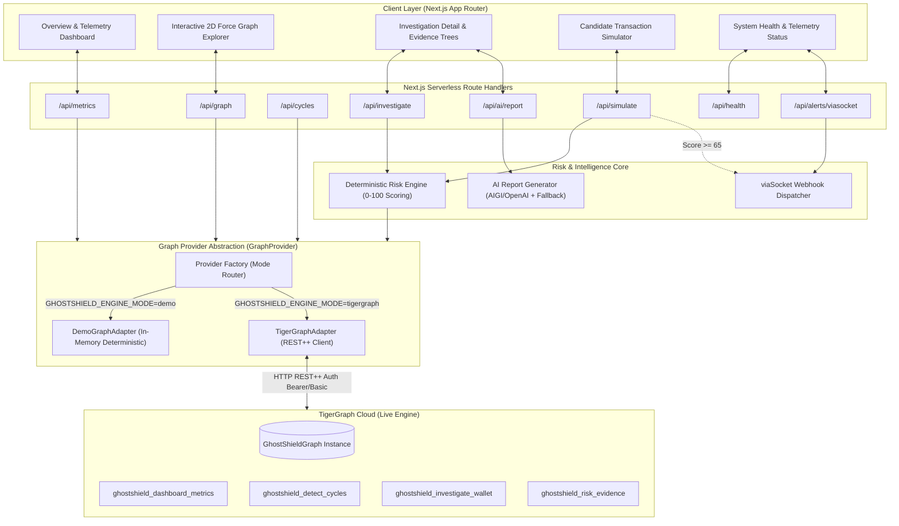

# GhostShield: System Architecture & Component Design

## 1. High-Level Architecture Overview

GhostShield is architected as a modular, graph-native security intelligence system. It decouples high-performance graph traversal (delegated to TigerGraph's Massively Parallel Processing engine) from deterministic risk policy evaluation and multi-channel alerting.

---

## 2. Component Boundaries & Responsibilities

### 2.1 Graph Provider Layer (`lib/graph/`)
* **Contract Interface (`GraphProvider`):** Standardizes all graph analytics into five typed methods:
  * `getDashboardMetrics(): Promise<DashboardMetrics>`
  * `investigateWallet(walletId, maxHops): Promise<WalletInvestigation>`
  * `detectCycles(timeWindowSeconds, maxDepth): Promise<CycleDetectionResult>`
  * `getRiskEvidence(walletId, candidateTx): Promise<RiskEvidence>`
  * `getGraphTopology(): Promise<GraphTopology>`
  * `checkHealth(): Promise<ProviderHealth>`
* **DemoGraphAdapter (`demo-adapter.ts`):** Self-contained, zero-dependency in-memory graph simulator seeded with standardized ground truth fixtures (`data/demo/entities.json`). Faithfully executes GSQL accumulator and temporal window semantics.
* **TigerGraphAdapter (`tigergraph-adapter.ts`):** Production client connecting to TigerGraph Cloud REST++ endpoints (`/restpp/query/{graph}/{query}`). Handles authentication tokens, header formatting, strict parameter validation, and connection error reporting.

### 2.2 Deterministic Risk Engine (`lib/risk/engine.ts`)
* **Authoritative Policy:** Evaluates five weighted risk signals:
  1. Temporally correlated directed cycles within $\Delta t \le 600\text{s}$ (up to 40 pts).
  2. Transaction volume retention and concentration $\ge 85\%$ (up to 15 pts).
  3. Shared upstream mixer/obfuscation funding (up to 20 pts).
  4. Direct 1-hop or 2-hop exposure to verified risk seeds (up to 55 pts).
  5. Multi-tier autonomous agent control or delegation (up to 10 pts).
* **Decisions:** Strict thresholds:
  * `ALLOW`: Score $0 \dots 34$
  * `REVIEW`: Score $35 \dots 64$
  * `REJECT`: Score $65 \dots 100$

### 2.3 AI Synthesis Engine (`lib/ai/report-generator.ts`)
* Integrates with AI Grants India (AIGI) / OpenAI endpoints when configured.
* Receives strictly structured evidence JSON.
* Employs deterministic template fallback when credentials are not present, ensuring zero failure surface in offline demo environments.
* The authoritative score is mathematical and never modified by LLM completions.

### 2.4 viaSocket Webhook Dispatcher (`lib/integrations/viasocket.ts`)
* Dispatches structured JSON alerts to viaSocket workflow automation when risk score crosses rejection threshold or when diagnostic pings are triggered.
* Enforces 4000ms timeout caps and non-blocking execution.
